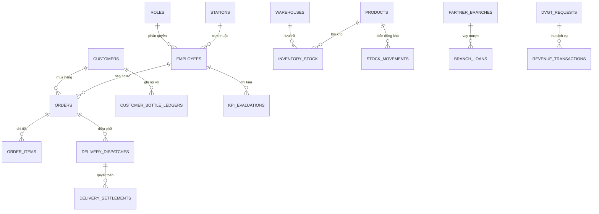

# TÀI LIỆU KIẾN TRÚC KỸ THUẬT HỆ THỐNG (SYSTEM ARCHITECTURE)
## Dự án: QAROMI ERP - Phần Mềm Quản Lý Bán Hàng & Điều Hành Doanh Nghiệp
**Đơn vị:** Xí Nghiệp Nước Hồng Gai - QUAWANCO
**Phiên bản:** 2.0.0 (Monorepo Standard)

---

## 1. Tổng Quan Kiến Trúc Monorepo

Dự án áp dụng mô hình **Monorepo** (npm workspaces), tách biệt Backend API, Frontend Web UI và Desktop Container:

```
                      +------------------------------------------+
                      |         Desktop Shell (Electron 43)      |
                      |      desktop/main.cjs & preload.cjs      |
                      +--------------------+---------------------+
                                           | fork (cwd = thư mục gốc)
                    +----------------------+----------------------+
                    |                                             |
                    v                                             v
       +-------------------------+                   +-------------------------+
       |   Frontend (@qaromi/web)|                   |   Backend (@qaromi/api) |
       |   React 19 + TypeScript |   REST API (JSON) |   Express 5 + TypeScript|
       |   Vite 8 + Tailwind v4  | <===============> |   Port 4325             |
       |   Recharts              |                   +------------+------------+
       |   Port 24925 (dev)      |                                |
       +-------------------------+                                v
                                                     +-------------------------+
                                                     |   SQLite (better-sqlite3)|
                                                     |   qaromi_erp.db (DUY NHẤT)|
                                                     +-------------------------+
```

### Ưu điểm
1. **Chia sẻ và tái sử dụng:** dùng chung type definitions, quy tắc nghiệp vụ và cấu hình giữa các package qua `apps/*`.
2. **Triển khai linh hoạt:**
   - **Ứng dụng Desktop nội bộ** (Offline / Local via Electron).
   - **Web Client - Server trong mạng LAN nội bộ** (máy chủ tại văn phòng, máy trạm kết nối qua trình duyệt).
3. **Hiệu năng cao:** SQLite + `better-sqlite3` đồng bộ (WAL mode).

### Một CSDL duy nhất
`apps/api/src/db.ts` xác định đường dẫn CSDL theo **thư mục gốc dự án** (không phụ thuộc `process.cwd()`), nên `npm run dev`, `npm start` và `npm run desktop:dev` đều dùng chung `qaromi_erp.db`. Ghi đè bằng biến môi trường `DB_PATH` khi cần.

---

## 2. Kiến Trúc Backend (`apps/api`)

### 2.1. Công nghệ
- **Runtime:** Node.js v20+, TypeScript chạy trực tiếp bằng `tsx watch` khi dev.
- **Framework:** Express 5, định tuyến RESTful, JSON payload, CORS.
- **CSDL:** `better-sqlite3` (synchronous, WAL), `PRAGMA foreign_keys = ON`.

### 2.2. Cấu trúc mã nguồn
```
apps/api/src/
├── server.ts        # Bootstrap: CORS, health-check, mount routers, phục vụ SPA, error middleware
├── db.ts            # Vòng đời kết nối CSDL, auto-migration (schema.sql), auto-seed (seed.sql)
├── schema.sql       # 25 bảng CSDL
├── seed.sql         # Dữ liệu ban đầu từ 3 file Excel
├── lib/
│   ├── http.ts      # ApiError, helper handle(), error middleware (chuẩn hoá mã lỗi)
│   ├── codes.ts     # Sinh mã chứng từ dựa trên MAX (không trùng sau khi xóa)
│   └── stock.ts     # applyStockDelta() (kiểm tra đủ tồn) + recordMovement() (nhật ký kho)
└── routes/
    ├── masterData.ts   # CRUD stations, roles, categories, warehouses,
    │                   #   partner_branches, customer_groups, product_conversions
    ├── products.ts     # Sản phẩm + tồn khởi tạo (có ghi nhật ký IMPORT)
    ├── customers.ts    # Khách hàng, sổ nợ vỏ, thu hồi vỏ độc lập
    ├── staff.ts        # Nhân sự, quyết toán ship, sổ vỏ nhân viên
    ├── orders.ts       # Đơn hàng (kiểm tra tồn, sổ kho, sổ quỹ, điều phối, hoàn kho khi hủy)
    ├── inventory.ts    # Tồn kho, cảnh báo, điều chuyển, điều chỉnh, nhật ký kho
    ├── branchLoans.ts  # Vay mượn (di chuyển kho) + quyết toán hoàn trả
    ├── delivery.ts     # Phiếu điều phối + quyết toán ca giao hàng
    ├── dvgt.ts         # Yêu cầu dịch vụ gia tăng (tự ghi sổ quỹ khi hoàn thành)
    ├── finance.ts      # Sổ quỹ thu/chi + tổng hợp dòng tiền
    ├── kpi.ts          # Chỉ tiêu KPI, tính thực tế, xếp loại, thưởng, duyệt
    └── dashboard.ts    # Tổng hợp số liệu cho bảng điều khiển & biểu đồ
```

### 2.3. Nguyên tắc nghiệp vụ then chốt
- **Kiểm tra đủ tồn trước khi xuất:** mọi thao tác trừ kho đi qua `applyStockDelta()`; thiếu hàng trả lỗi 400, không cho âm kho.
- **Nhật ký kho bắt buộc:** mọi biến động (`IMPORT`, `EXPORT_ORDER`, `TRANSFER_OUT/IN`, `LOAN_OUT/IN`, `ADJUSTMENT`) đều ghi vào `stock_movements`.
- **Bán hàng ghi đủ 3 sổ:** trừ kho + `stock_movements`, cập nhật nợ vỏ + `customer_bottle_ledgers`, ghi `revenue_transactions` khi thu tiền; tạo `delivery_dispatches` khi có shipper.
- **Hủy đơn hoàn tác đầy đủ:** hoàn kho, đảo nợ vỏ, xóa ledger, xóa phiếu thu và phiếu điều phối liên quan.
- **Sinh mã chứng từ** dựa trên giá trị lớn nhất hiện có (`DH-…`, `KH…`, `NV…`, `VM-…`, `DP-…`, `PT-…`, `PC-…`, `DV-…`).
- **Parameterized queries** toàn bộ; giao dịch ACID cho các nghiệp vụ nhiều bước.

---

## 3. Kiến Trúc Frontend (`apps/web`)

### 3.1. Công nghệ
- **Framework:** React 19, TypeScript, **Vite 8**.
- **Styling:** **Tailwind CSS v4 build thật** (`@tailwindcss/vite`) + design token QAROMI trong `src/index.css` (`@theme`).
- **Biểu đồ:** **Recharts**.
- **Icons:** lucide-react.

### 3.2. Cấu trúc mã nguồn
```
apps/web/src/
├── App.tsx                  # Shell: Sidebar + Topbar + điều hướng 12 phân hệ
├── layout.ts                # Cấu hình nav (12 tab, nhóm menu, tiêu đề)
├── api.ts                   # HTTP client có type, xử lý lỗi tập trung (ApiError)
├── types.ts                 # Types cho toàn bộ thực thể
├── index.css                # Tailwind v4 + token thương hiệu
├── lib/                     # cn.ts, format.ts (tiền/ngày/số), hooks.ts (useApi, useDebounced)
├── context/ReferenceContext.tsx  # Nạp & chia sẻ dữ liệu danh mục dùng chung
├── components/
│   ├── layout/              # Sidebar, Topbar
│   └── ui/                  # Button, Card, StatCard, Badge, Modal, DataTable, Field,
│       │                    #   Toast, ConfirmDialog, Tabs, EmptyState, Spinner, PageHeader
│       └── charts/          # ChartCard, LineTrend, AreaTrend, BarSeries, DonutChart
└── features/
    ├── overview/            # Dashboard + 12 biểu đồ
    ├── sales/               # Đơn hàng + modal lập đơn nhiều dòng
    ├── delivery/            # Điều phối + quyết toán ca
    ├── customers/           # Khách hàng + sổ nợ vỏ
    ├── products/            # Sản phẩm & bảng giá
    ├── warehouse/           # Tồn kho, điều chuyển, nhật ký kho
    ├── branchloans/         # Vay mượn liên chi nhánh
    ├── kpi/                 # Chỉ tiêu KPI
    ├── dvgt/                # Dịch vụ gia tăng
    ├── finance/             # Sổ quỹ thu - chi
    ├── staff/               # Nhân sự
    └── settings/            # Danh mục hệ thống
```

### 3.3. Nguyên tắc UI/UX
- **Một bộ component dùng chung** thay cho markup copy-paste; bảng dữ liệu có sắp xếp, tìm kiếm, phân trang, trạng thái rỗng/đang tải.
- **Phản hồi người dùng** qua Toast (không dùng `alert()`), xác nhận thao tác nguy hiểm qua `ConfirmDialog` (không dùng `window.confirm`).
- **Modal thống nhất:** hỗ trợ `size`, đóng bằng ESC/backdrop, `role="dialog"`.
- **Responsive:** Sidebar thu gọn trên màn hình nhỏ, lưới biểu đồ tự co giãn.
- **Brand palette QAROMI** khai báo một lần trong `@theme` (`brand-navy`, `brand-cyan`, `brand-red`, `brand-cream`...) và dùng qua class Tailwind.

### 3.4. Bảng màu thương hiệu
| Token | Mã | Ứng dụng |
| :--- | :--- | :--- |
| `brand-navy` | `#2C2C6B` | Nút hành động chính, thẻ thống kê |
| `brand-navy-dark` / `-darker` | `#1B1B4B` / `#14143B` | Sidebar, header modal |
| `brand-cyan` | `#50ADDE` | Accent, link, trạng thái active |
| `brand-red` | `#C62430` | Cảnh báo, nút hủy/xóa |
| `brand-cream` | `#FFFBB2` | Huy hiệu, điểm nhấn |

---

## 4. Kiến Trúc Desktop Shell (`desktop`)

- **Nền tảng:** Electron 43.
- `desktop/main.cjs`: fork `apps/api/dist/server.js` với `cwd = thư mục gốc`, chờ `/api/health` rồi mở `BrowserWindow` (1480×920, min 1200×760), tự dừng server khi thoát.
- `desktop/preload.cjs`: `contextBridge` expose `window.qaromiErp`; `contextIsolation: true`, `nodeIntegration: false`.

---

## 5. Cơ Sở Dữ Liệu SQLite (25 Bảng)

### 5.1. Nhóm bảng
1. **Danh mục nền:** `stations`, `roles`, `categories`, `partner_branches`, `warehouses`, `customer_groups`, `product_conversions`.
2. **Nhân sự:** `employees`.
3. **Hàng hóa:** `products`.
4. **Khách hàng:** `customers`.
5. **Kho bãi:** `inventory_stock`, `stock_movements`.
6. **Bán hàng & giao vận:** `orders`, `order_items`, `delivery_dispatches`, `delivery_settlements`.
7. **Sổ vỏ bình:** `customer_bottle_ledgers`, `employee_bottle_ledgers`.
8. **Liên chi nhánh:** `branch_loans`, `branch_loan_items`, `branch_loan_settlements`.
9. **DVGT & tài chính:** `dvgt_requests`, `revenue_transactions`, `expense_transactions`.
10. **KPI:** `kpi_evaluations`.

> Tất cả 25 bảng đều đã có API và màn hình quản lý tương ứng (danh mục CRUD đầy đủ ở phân hệ *Danh mục hệ thống*).

### 5.2. Sơ đồ quan hệ chính


### 5.3. An toàn dữ liệu
1. `PRAGMA foreign_keys = ON` trên mọi kết nối.
2. Giao dịch ACID cho bán hàng, hủy đơn, điều chuyển kho, vay trả, quyết toán.
3. 100% truy vấn dùng Prepared Statements (chống SQL Injection).
4. Kiểm tra đủ tồn trước khi xuất kho; mọi biến động đều có nhật ký.

---

## 6. Tầng mã nguồn cũ (Legacy)

Thư mục `_legacy/` chứa bản Electron-IPC cũ (`src/`, `preload.js`, `qaromi_erp.sqlite`) và bản sao CSDL phát sinh khi chạy API với `cwd=apps/api`. **Không tham gia build/run.** Xem chi tiết tại `_legacy/README.md`.

---

## 7. Lệnh vận hành
```powershell
npm install --include=dev   # Cài đặt (bắt buộc có --include=dev nếu NODE_ENV=production)
npm run dev                 # API :4325 + Web :24925
npm run build               # Typecheck + build cả API và Web
npm start                   # Chạy API đã build (phục vụ luôn SPA)
npm run desktop:dev         # Build + mở ứng dụng Electron
```
