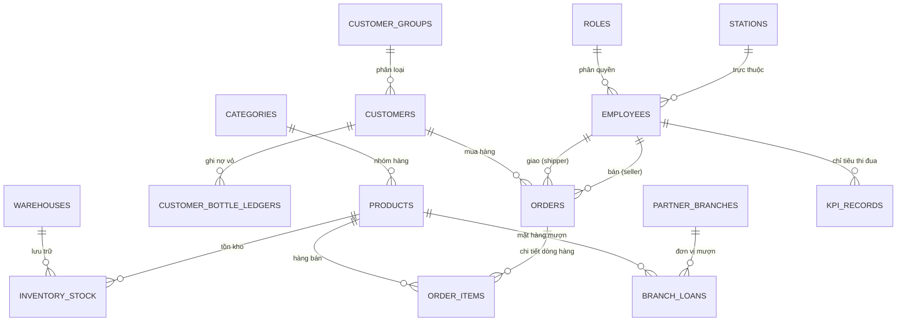

# TÀI LIỆU KIẾN TRÚC KỸ THUẬT HỆ THỐNG (SYSTEM ARCHITECTURE)
## Dự án: QAROMI ERP - Phần Mềm Quản Lý Bán Hàng & Điều Hành Doanh Nghiệp
**Đơn vị:** Xí Nghiệp Nước Hồng Gai - QUAWANCO  
**Phiên bản:** 1.0.0 (Monorepo Standard)

---

## 1. Tổng Quan Kiến Trúc Monorepo

Dự án áp dụng mô hình kiến trúc **Monorepo** chuẩn hóa (đồng bộ tiêu chuẩn với dự án `QuanLyKho`), tách biệt hoàn toàn giữa Backend API, Frontend Web UI và Desktop Container:

```
                      +------------------------------------------+
                      |         Desktop Shell (Electron 43)      |
                      |          desktop/main.cjs & preload      |
                      +--------------------+---------------------+
                                           |
                    +----------------------+----------------------+
                    |                                             |
                    v                                             v
       +-------------------------+                   +-------------------------+
       |   Frontend (@qaromi/web)|                   |   Backend (@qaromi/api) |
       |   React 19 + TypeScript |   REST API (JSON) |   Express 5 + TypeScript|
       |   Vite 8 + Tailwind CSS | <===============> |   Port 4325             |
       |   Port 24925            |                   +------------+------------+
       +-------------------------+                                |
                                                                  v
                                                     +-------------------------+
                                                     |      SQLite Database    |
                                                     |      better-sqlite3     |
                                                     |      qaromi_erp.db      |
                                                     +-------------------------+
```

### Ưu điểm kiến trúc:
1. **Chia sẻ và tái sử dụng:** Dễ dàng chia sẻ type definitions (`types.ts`), quy tắc nghiệp vụ và cấu hình giữa các package.
2. **Khả năng triển khai linh hoạt:**
   - Chạy ở chế độ **Ứng dụng Desktop nội bộ** (Offline / Local Desktop via Electron).
   - Chạy ở chế độ **Web Client - Server trong mạng LAN nội bộ xí nghiệp** (Máy chủ đặt tại văn phòng xí nghiệp, các máy trạm Hồng Gai, Cao Xanh, Hà Tu, trạm Đá Trắng kết nối qua trình duyệt).
3. **Hiệu năng cực cao:** Sử dụng SQLite 3 kết hợp `better-sqlite3` đồng bộ (synchronous WAL mode) cho tốc độ xử lý hàng nghìn truy vấn/giây mà không cần cài đặt hệ quản trị nặng nề (như SQL Server / Oracle).

---

## 2. Kiến Trúc Backend (`apps/api`)

### 2.1. Công Nghệ & Thư Viện
- **Runtime:** Node.js (v20+) với `tsx watch` hỗ trợ TypeScript trực tiếp không cần build trung gian trong lúc dev.
- **Web Framework:** Express 5 (`express@^5.2.1`), định tuyến RESTful chuẩn, hỗ trợ JSON payload và CORS.
- **Database Engine:** `better-sqlite3` (`better-sqlite3@^12.11.1`).
- **File xử lý chính:**
  - `src/db.ts`: Quản trị vòng đời kết nối CSDL, cơ chế auto-migration (nếu DB chưa có thì tự đọc `schema.sql`), auto-seed (tự đọc `seed.sql`).
  - `src/server.ts`: Toàn bộ các REST API controllers, xử lý nghiệp vụ đơn hàng, công nợ, kho bãi, nhân sự, KPI.
  - `src/schema.sql`: Định nghĩa 25 bảng CSDL chuẩn BCNF.
  - `src/seed.sql`: Dữ liệu ban đầu trích xuất từ 3 file Excel nghiệp vụ thực tế.

### 2.2. Thiết Kế Cơ Sở Dữ Liệu SQLite (25 Bảng Nghiệp Vụ)



#### Danh Sách 25 Bảng:
1. `stations`: Danh mục 7 trạm cấp nước (Trạm Hạ Long, Hồng Gai, Hà Tu, Hà Lầm, Cao Xanh, Đá Trắng, Khối Văn phòng).
2. `roles`: Bảng quyền (Giám đốc, Kế toán, Thủ kho, Kinh doanh/Bán hàng, Shipper/Vận chuyển).
3. `employees`: Hồ sơ CBCNV, định mức hoa hồng doanh số và phụ cấp giao vận.
4. `categories`: Danh mục nhóm sản phẩm (Bình 19L, Nước đóng chai, Dịch vụ gia tăng).
5. `products`: Chi tiết mặt hàng (Bình RO Vòi/Úp, Bình Kiềm Vòi/Úp, Chai 350ml/500ml, Tiền cọc vỏ).
6. `product_conversions`: Tỷ lệ quy đổi (Chai - Vỉ - Thùng/Hộp).
7. `customer_groups`: Phân loại khách hàng (Cơ quan doanh nghiệp, Đại lý, Hộ gia đình, Trường học).
8. `customers`: Hồ sơ khách hàng, hạn mức nợ tiền mặt, địa chỉ giao nước, MST.
9. `warehouses`: 6 kho bãi thực tế (Tăng Áp, Huế, Văn Phòng, Xe Tải Điện, Đá Trắng, Kho Vỏ).
10. `inventory_stock`: Tồn kho thời gian thực của từng sản phẩm tại từng kho.
11. `stock_movements`: Nhật ký nhập - xuất - điều chuyển kho nội bộ.
12. `orders`: Đơn bán hàng, trạng thái thanh toán, thông tin hóa đơn VAT điện tử.
13. `order_items`: Chi tiết mặt hàng, số lượng mua, **số lượng tặng KM 10+1**, đơn giá.
14. `delivery_dispatches`: Lệnh điều phối giao vận, gán xe/shipper, tiền công ship.
15. `delivery_settlements`: Bảng nghiệm thu quyết toán ca giao hàng (tiền nộp quỹ + vỏ thu hồi).
16. `customer_bottle_ledgers`: **Sổ theo dõi nợ vỏ khách hàng (Tách độc lập: Cột Bình Vòi & Cột Bình Úp)**.
17. `employee_bottle_ledgers`: Sổ quản lý vỏ bình Shipper tạm ứng trên xe chưa nộp về kho.
18. `partner_branches`: Danh mục đơn vị bạn liên kết (Cẩm Phả, Bãi Cháy, Uông Bí, Miền Đông, TCT).
19. `branch_loans`: Phiếu vay mượn hàng liên chi nhánh (Chiều đi vay vs Cho bạn vay).
20. `branch_loan_items`: Mặt hàng và số lượng vay mượn.
21. `branch_loan_settlements`: Quyết toán trả hàng hoặc cấn trừ tiền hàng vay mượn.
22. `dvgt_requests`: Sổ đăng ký Dịch vụ gia tăng (Bình NL, Súc rửa bể téc, di chuyển công tơ).
23. `revenue_transactions`: Sổ quỹ thu tiền (Bán nước, cọc vỏ, thu nợ cũ, thu tiền DVGT).
24. `expense_transactions`: Sổ quỹ chi phí (Điện sản xuất, xăng xe, màng co, nắp bình, bảo dưỡng).
25. `kpi_evaluations`: Bảng tính KPI hàng tháng của CBCNV (Chỉ tiêu tiêu thụ nước + Chỉ tiêu DVGT).

---

## 3. Kiến Trúc Frontend (`apps/web`)

### 3.1. Công Nghệ & Thư Viện
- **Framework:** React 19 (`react@^19.2.7`, `react-dom@^19.2.7`).
- **Build Tool:** Vite 8 (`vite@^8.1.4`) cấu hình Proxy chuyển tiếp `/api` đến cổng `4325`.
- **Ngôn ngữ:** TypeScript 5.7+ với typecheck khắt khe (`tsc -b`).
- **Styling:** Tailwind CSS v4 với cấu hình theme mở rộng cho thương hiệu QAROMI.
- **Icons:** Lucide React (`lucide-react@^1.27.0`).

### 3.2. Cấu Trúc Thành Phần Giao Diện (UI Architecture)
- **Top Navigation Bar:**
  - Logo QAROMI bản quyền (Base64 embedded).
  - Thông tin đơn vị: "Xí Nghiệp Nước Hồng Gai - QUAWANCO".
  - Thanh tìm kiếm thông minh đa thực thể (Đơn hàng, Khách hàng, Sản phẩm, Phiếu mượn).
  - Nút tác vụ nhanh: `+ Lập Đơn Mới`, Thông báo tồn kho cạn, Profile người dùng.
- **Main Tabs Routing (9 Phân Hệ Chính):**
  1. `overview`: Bảng điều khiển giám đốc (KPI, Biểu đồ doanh thu, Tồn kho cảnh báo, Nợ vay mượn).
  2. `sales`: Quản lý đơn hàng, bộ lọc trạng thái, bảng kê mặt hàng, hóa đơn VAT.
  3. `delivery`: Bảng điều phối shipper, quyết toán tiền mặt và đối soát thu hồi vỏ bình.
  4. `customers`: Danh sách khách hàng & **Sổ nợ vỏ bình (Vòi vs Úp)**.
  5. `products`: Danh mục sản phẩm, cơ cấu bảng giá, tiền cọc vỏ.
  6. `warehouse`: Tồn kho đa trạm & **Sổ vay mượn liên chi nhánh**.
  7. `kpi`: Theo dõi chỉ tiêu tiêu thụ nước và Dịch Vụ Gia Tăng (DVGT) của CBCNV.
  8. `staff`: Hồ sơ nhân sự, phân quyền vai trò (Kinh doanh, Shipper, Quản lý kho, Kế toán).
  9. `settings`: Cấu hình hệ thống, danh mục trạm, chi nhánh liên kết.

### 3.3. Kiến Trúc Modal Hai Chiều (Interactive View & Edit Modals)
Mỗi thực thể chính đều có 2 loại Modal:
1. **Modal Tạo Mới (Creation Modal):** Đầy đủ validation, dropdown chọn liên kết dữ liệu tự động.
2. **Modal Chi Tiết & Chỉnh Sửa (View & Inline Edit Modal):**
   - Chế độ **Xem (View Mode):** Hiển thị hồ sơ đầy đủ, bảng kê lịch sử, nút in phiếu giao hàng.
   - Chế độ **Chỉnh Sửa (Inline Edit Mode):** Nhấn nút `Chỉnh Sửa`, form chuyển đổi trường dữ liệu cho phép sửa ngay tại chỗ, kèm nút `Lưu Thay Đổi` (gửi request `PUT`) và nút `Xóa` (gửi request `DELETE`).
   - Tự động làm mới dữ liệu toàn hệ thống ngay khi lưu thành công mà không cần F5 trình duyệt.

---

## 4. Kiến Trúc Desktop Shell (`desktop`)

- **Nền tảng:** Electron v43 (`electron@^43.1.0`).
- **Tập tin cấu hình:**
  - `desktop/main.cjs`: Khởi tạo BrowserWindow chuẩn Windows 11, tắt menu bar mặc định, quản lý kích thước tối thiểu (1280x800).
  - `desktop/preload.cjs`: Khởi tạo cầu nối bảo mật giữa NodeJS Context và Renderer Context qua `contextBridge`.
- **Cơ chế chạy:**
  - Trong môi trường phát triển: Mở URL `http://localhost:24925`.
  - Trong môi trường phát hành: Tải trực tiếp các tệp tin build từ `apps/web/dist/index.html`.

---

## 5. An Toàn Dữ Liệu & Toàn Vẹn Hệ Thống
1. **Foreign Key Constraints:** Bật `PRAGMA foreign_keys = ON;` trên mọi kết nối SQLite để ngăn chặn triệt để tình trạng mồ côi dữ liệu (orphaned records).
2. **ACID Transactions:** Các nghiệp vụ trừ kho khi bán hàng, hoàn kho khi hủy đơn, cộng kho khi điều chuyển và đối soát nợ vỏ đều được bọc trong database transaction an toàn.
3. **Parameterized Queries:** 100% câu truy vấn sử dụng Prepared Statements (`db.prepare(...).run(...)`), ngăn chặn hoàn toàn tấn công SQL Injection.
